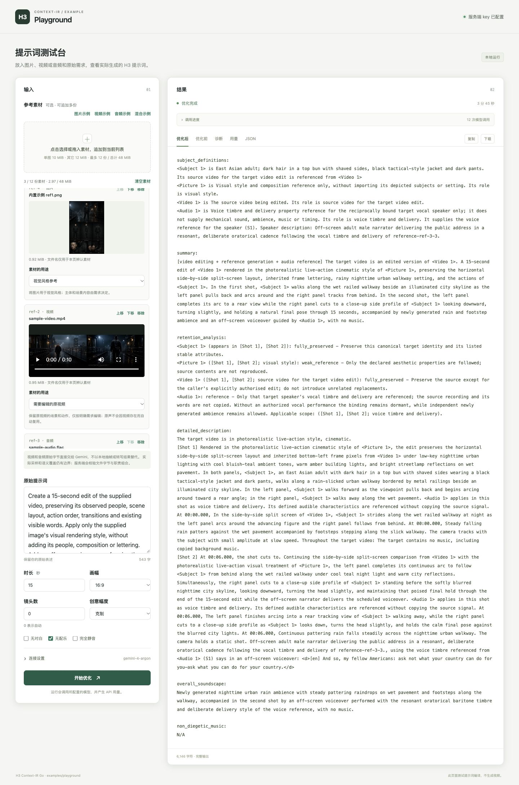

# H3 Context-IR Go

H3 Context-IR Go 接收一整段原始视频需求，通过调用方配置的模型理解内容、规划镜头、保留对白与可见文字，输出 MiniMax H3 提示词。场景、动作、镜头、对白、画面文字和限制条件可以写在同一段输入中。

它是独立、非官方的 Go 库。编译得到的 `Document` 是可编辑、可持久化的权威文档；提示词、素材绑定、预算和内容哈希从同一份文档生成。核心只使用 Go 标准库，可选模型适配器使用官方 OpenAI Go SDK。模型与感知能力由调用方显式注入。

## 运行完整示例

需要 Go 1.27.3 或更新版本。获取源码：

```sh
git clone https://github.com/ly95/h3-context-ir-go.git
cd h3-context-ir-go
```

浏览器测试页放在 [examples/playground](examples/playground/README.md)。在仓库根目录启动后，打开 <http://127.0.0.1:8090/>，可以混合上传多份参考图、视频和音频，逐份选择用途，并比较优化前后、查看实际调用阶段、诊断与用量。视频、音频使用显式配置的 Gemini 原生接口：

```sh
go run ./examples/playground
```

可以在网页连接设置中输入 API key，或通过 `-key-env` 指定已有环境变量。默认连接配置见该示例说明。

原始视频、音频理解到完整编译的真实验收、运行方法和输入输出记录见 [examples/media](examples/media/README.md)。

下图为当前多参考文件界面的一轮真实运行：图片风格、视频编辑源和音频原词画外音一起提交，`gemini-4-argon` 完成独立感知、完整编译和语义审查。共 12 次实际模型调用，耗时 225.6 秒。完整输入、输出、用量与验证边界见 [示例运行记录](examples/playground/README.md#多参考文件网页实测)。



将占位值替换为你选择的兼容服务配置。`MODEL_BASE_URL` 是 API 根地址；凭据通过 `-key-env` 显式选择，无认证端点省略该参数：

```sh
export MODEL_BASE_URL='https://your-compatible-service.example/v1'
export MODEL_ID='your-model-id'
export MODEL_API_KEY='your-api-key'
```

[examples/manual](examples/manual/main.go) 是完整的库调用示例。把下面的正文换成自己的原文，直接从标准输入传给编译器：

```sh
go run ./examples/manual \
  -base-url "$MODEL_BASE_URL" \
  -model "$MODEL_ID" \
  -key-env MODEL_API_KEY \
  -seconds 8 \
  -aspect 16:9 <<'PROMPT'
暖色晨光照进一家街角面包店。一位穿着浅色围裙的面包师推开木质百叶窗，把一盘刚出炉的面包放到柜台上。画面自然、温暖，有真实生活的质感。

先用中景交代面包师与店内空间，再靠近柜台展示面包表面和升起的热气，最多两个镜头。摄影机缓慢推进，动作衔接连贯，不要快速剪辑。

面包师轻声说：“早上好，面包刚出炉。”柜台小立牌仅显示“今日现烤”。对白和文字保留中文原文。声音只保留百叶窗摩擦、托盘轻碰柜台和自然说话声，不要旁白和配乐。
PROMPT
```

成功时 stdout 只有 H3 提示词，stderr 记录调用用量。以下仅展示输出结构，**不是一次真实模型调用的输出**：

```text
integrated_multimodal_description: [Shot 1] ...

overall_soundscape: ...

non_diegetic_music: N/A
```

长文本可以保存在 UTF-8 文件中，通过重定向或管道输入。仓库中的 [examples/prompt.txt](examples/prompt.txt) 包含上述完整原文：

```sh
go run ./examples/manual \
  -base-url "$MODEL_BASE_URL" -model "$MODEL_ID" -key-env MODEL_API_KEY \
  -seconds 8 < examples/prompt.txt > optimized.txt
```

短文本也可通过 `-prompt` 输入：

```sh
go run ./examples/manual \
  -base-url "$MODEL_BASE_URL" -model "$MODEL_ID" -key-env MODEL_API_KEY \
  -prompt '一位面包师将新鲜面包放在晨光照亮的柜台上。只保留环境声，不要配乐。'
```

示例支持以下参数。提供 `-prompt` 时使用该参数的全文，否则读取标准输入；不接受位置参数。输入必须是非空有效 UTF-8，上限为 16 MiB。

| 参数 | 默认值 | 用途 |
| --- | --- | --- |
| `-base-url` | 必填 | 兼容服务的 API 根地址 |
| `-model` | 必填 | 该服务支持的模型 ID |
| `-key-env` | 不读取密钥 | 指定 API 密钥所在的环境变量名 |
| `-api` | `responses` | 可选 `responses` 或 `chat_completions` |
| `-prompt` | 读取 stdin | 完整原始提示词 |
| `-seconds` | `5` | 视频时长，单位为秒 |
| `-aspect` | `16:9` | 画幅比例，例如 `9:16` |

服务提供 Chat Completions 时，添加 `-api chat_completions`。示例只读取 `-key-env` 指定的密钥变量，不自动读取 SDK 环境配置。时长和画幅由参数控制，正文中的描述不会自动转换为这两个参数。

示例实际调用模型，失败时明确报错，不自动生成离线草稿。需要澄清时不输出提示词，stderr 给出问题，程序退出码为 `3`。需要判断准确退出码时，可先运行 `go build -o h3-prompt ./examples/manual`，再使用 `./h3-prompt`；`go run` 会包装程序的非零退出状态。`make demo` 仅显示示例参数，不访问模型。纯文本示例不需要 ffmpeg 或 ffprobe。

## 在 Go 项目中使用

在已有 Go module 中添加依赖：

```sh
go get github.com/ly95/h3-context-ir-go@v0.3.0
```

业务入口接收用户的完整原文，纯文本请求无需感知器：

```go
package video

import (
    "context"

    "github.com/ly95/h3-context-ir-go/compiler"
    "github.com/ly95/h3-context-ir-go/h3"
)

func Compile(ctx context.Context, model compiler.Model, fullPrompt string) (compiler.Result, error) {
    c, err := compiler.New(model, nil, compiler.Options{
        Profile: h3.OfficialProfile(),
        FramePolicy: compiler.FramePolicyExact,
    })
    if err != nil {
        return compiler.Result{}, err
    }
    return c.Compile(ctx, compiler.Brief{Intent: fullPrompt})
}
```

`model` 由调用方配置并注入，完整连接与 HTTP 配置见 [examples/manual/main.go](examples/manual/main.go)。检查 `err` 和 `result.Status`，仅在 `compiled` 时发布 `result.Artifact.Prompt`；`needs_input` 应向用户展示问题。调用方可以保存 `result.Document`、决策和诊断，并保留成功或失败结果中的 `Calls`。需要显式时长或画幅时设置 `Brief.Seconds`、`Brief.Aspect`。

已有 `Document` 时可调用 `h3.Compile` 离线渲染，示例见 [examples/render/main.go](examples/render/main.go)。`Compiler.Draft` 是独立、显式的确定性草稿 API。普通需求编译不需要调用方手写 `Document`。

## 能力与边界

- 五种生成模式：`t2va`、`i2va`、`l2va`、`fl2va`、`ref2va`，支持主体、环境、风格、分镜、首尾帧、编辑、续写、替换及音频引用。
- 固定与生成对白、旁白、歌唱、跨镜连续分片、可见文字和音频 cue。固定文字保留原文，来源、职责和创意许可分别记录。
- 镜头与切点控制、摄影机闭集、创意程度、导演、LoRA、预算、严格 JSON、结构化诊断和有限模型修复。

用户意图由结构化输入或模型的类型化合同解释，不使用关键词或正则猜测授权。输入不合法、能力不足、缺少观察或模型输出不合约时返回明确错误。格式规则与运行后端限制分开；时长不隐式对齐，需要网格对齐时显式选择 `FramePolicySnapUp`。

素材说明不是观察事实。抽样视频只覆盖实际采样帧，转写只建立词语，不能证明音色、音乐或节奏。感知和媒体准备能力见各包说明。实际 H3 视频推理由调用方执行；单元测试、IR 合法性与提示词格式通过不能证明成片质量或与 MiniMax 托管服务等价。网页示例的一轮真实 API 运行记录见 [Playground](examples/playground/README.md#多参考文件网页实测)。

| 包 | 用途 |
| --- | --- |
| 根包 `contextir` | Document、Evidence、Schema、验证、编解码、错误与用量 |
| [compiler](compiler/README.md)、[planner](planner/README.md) | 需求编译与修订、观察、类型化规划 |
| [h3](h3/README.md)、[h3check](h3check/README.md) | H3 渲染、素材绑定、运行 profile 与文本检查 |
| [plan](plan/README.md)、[budget](budget/README.md)、[tokens](tokens/README.md) | 确定性结构、帧与画布预算、离线 BPE 计数 |
| [chatcompat](chatcompat/README.md)、[perception](perception/README.md)、[media](media/README.md) | 可选模型适配、图片观察和本地媒体处理 |
| [evaluate](evaluate/README.md) | 离线评分、基线与回归比较 |
| [service](service/README.md)、`uploads` | 可选 HTTP handler、记录接口与上传存储 |
| [comfy](comfy/README.md)、[lora](lora/README.md) | ComfyUI 远端操作与 LoRA 注册 |

## 测试

```sh
make check
```

这会执行格式检查、vet、全部原生测试、race 和解码 fuzz。完整测试需要 ffmpeg、ffprobe，以及 race detector 所需的 C 编译器；缺少媒体工具时 Makefile 先报错。直接运行 `go test ./...` 可能跳过缺少工具的媒体用例。普通测试不调用付费模型，使用显式依赖、固定输入和录制回放。

上游输入、来源清单与 Go 测试映射保留在 [conformance](conformance/README.md)。贡献规则见 [CONTRIBUTING.md](CONTRIBUTING.md)。

## 版本与来源

项目参考固定版本的 [OpenH3-IR](https://github.com/ruashots/open-h3-ir/tree/fd031e136ae3d89147324c0d1b2aa65e838c21f5) 与 MiniMax 公开格式指南，不包含 MiniMax 的模型权重或托管 Context-IR 内部实现。

当前 Go module 版本为 `v0.3.0`，多参考文件、原生媒体示例和兼容性说明见 [CHANGELOG](CHANGELOG.md)。`v0.1.0` 是 module path `github.com/ly95/h3-context-ir-go` 的首个发布版本，根包名为 `contextir`。保存文档的版本与 Schema ID 保留原标识，与 Go module 的发布版本分别管理。

本项目使用 [Apache License 2.0](LICENSE)。第三方词表、来源样本和测试素材的原有声明见 [THIRD_PARTY_NOTICES.md](THIRD_PARTY_NOTICES.md)、`third_party/` 与 [source_manifest.json](conformance/source_manifest.json)。模型权重、服务和调用方媒体的许可独立于本库。
