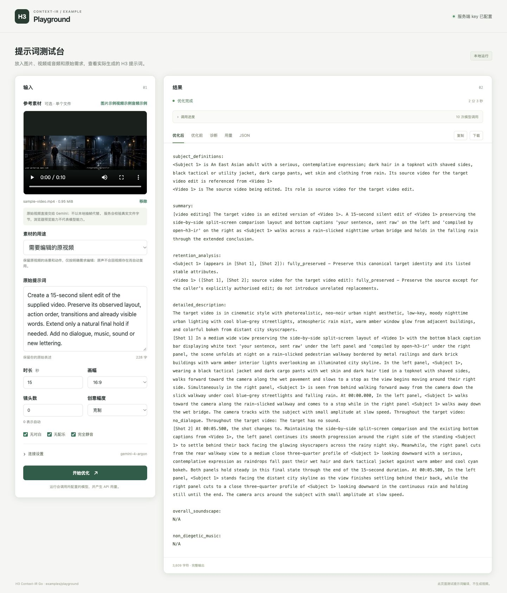
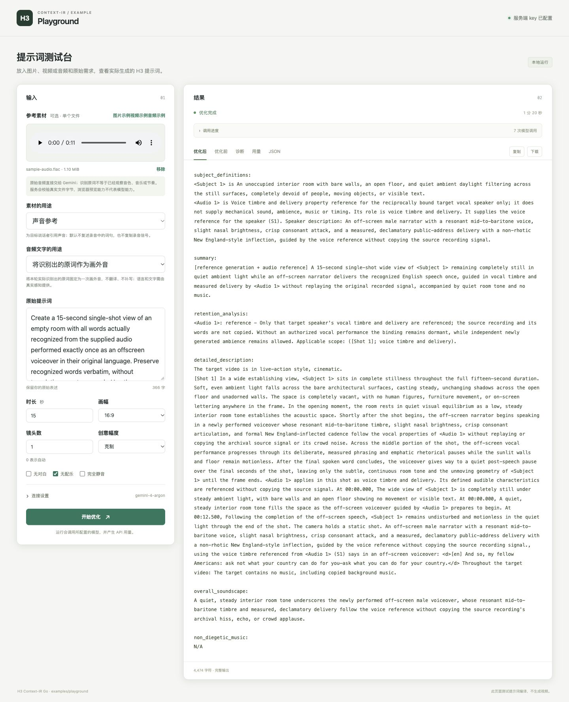

# 本地测试网页

这个示例在本机提供文本和多个图片、视频、音频附件的编译表单，直接调用当前 Go 库。网页展示模型阶段、调用用量、编译结果和失败诊断；它不连接 CLW 或其生产环境。

在仓库根目录运行：

```sh
go run ./examples/playground \
  -addr 127.0.0.1:8090 \
  -base-url https://api.deepseek.com/ \
  -model deepseek-flash \
  -api responses \
  -key-env DEEPSEEK_API_KEY \
  -sample-image third_party/open-h3-ir/testdata/golden/assets/ref1.png
```

打开 <http://127.0.0.1:8090/>。监听地址、API 地址、模型和协议默认值就是上面这些值；可以通过对应参数或表单显式修改。默认请求 `deepseek-flash`，返回模型名须与请求一致。供应商确实使用不同的规范模型名时，可通过 `-allowed-response-models` 显式允许；该参数不会更换请求模型。

无需先配置环境变量：可以在网页中输入 API key，随编译请求发送。也可以通过 `-key-env` 指定已有环境变量名。示例不保存 key，也不把服务端环境 key 返回给网页。环境 key 仅用于启动时配置的完整 API 地址；在网页中更换 API 地址时，应为该请求提供 key。

提交会调用真实模型，使用量按供应商规则计费。示例不会通过切换模型、丢弃媒体或生成离线草稿来隐藏失败。

API 协议必须明确选择。多张图片继续支持 Responses / Chat；包含视频或音频的混合素材必须选择 `gemini`，通过原生接口发送原始视频或音频，不会自动改协议或模型。可主动点击 OpenCode Go / Gemini 预设，将协议、地址和模型分别设为 `gemini`、`https://opencode.ai/inference/go/google/v1beta` 和 `gemini-4-argon`。预设不填入或保存 key，也不代表自动回退路径。

使用已有 OpenCode Go key 的环境变量启动原生媒体网页：

```sh
go run ./examples/playground \
  -base-url https://opencode.ai/inference/go/google/v1beta \
  -model gemini-4-argon \
  -api gemini \
  -key-env OPENCODE_GO_API_KEY
```

音视频校验需要 `ffprobe` 和 `ffmpeg`，可通过同名启动参数指定可执行文件。上传字节
保留在内存中；音视频还会写入权限为 `0600` 的临时文件完成探测和完整解码校验，
请求结束或失败时清理。图片也可使用 Gemini 原生协议。

图片、视频和音频各有独立示例按钮，不会切换 API 或模型；Gemini 预设需要另行主动选择。示例按钮把原始 Blob 追加到素材列表，不清除已有附件。视频和音频示例使用公开素材，分别从 `/sample-video` 和 `/sample-audio` 读取原始文件，再按各自稳定 ID 上传到 `FormData` 的 `media.<id>` 文件字段，经过与手动上传相同的处理，不走 `sample=true` 旁路。可通过 `-sample-video`、`-sample-audio` 显式配置本地示例文件；`GET /api/config` 的 `sample_video_available`、`sample_audio_available` 声明其是否可用。

“混合示例”按钮一次完整追加图片 `style`、视频 `edit_source` 和音频 `voice_timbre`／`transcript_voiceover`，不清除已有素材、不切换 API 或模型。它设置 15 秒、镜头数 0（自动）、无配乐并允许画外音；通用要求只按图片的渲染风格调整原视频，不添加图片中的人物、排版或文字，画外音使用实际音频原词。

## 输入和结果

- 可以使用纯文本，或通过支持多选的文件选择器、拖入文件、示例按钮向列表追加素材；再次添加不会替换已有附件。每张素材卡有独立的职责、音频用途、上移、下移和移除操作，也可清空列表。素材使用稳定的 `ref-N` ID，移动时 ID 不变，删除后不复用该 ID；提交的 metadata 顺序保留列表顺序并作为权威输入顺序。
- 图片支持 PNG/JPEG，单张最多 10 MiB、最多 1600 万像素；视频支持 MP4/WebM，完整解码实测至少 5 帧，其他 Matroska 容器不能冒充 WebM；音频支持 FLAC/WAV/MP3/Ogg，视频和音频单个最多 12 MiB。最多上传 12 个附件、合计 48 MiB。公开配置中的 `max_image_bytes`、`max_media_bytes`、`max_reference_files`、`max_total_media_bytes` 分别声明这些上限。
- 上传的 12 个／48 MiB 上限与 H3 运行时 profile 的图片、视频、音轨槽位限制不同；运行时可能在更少附件时明确拒绝。示例不会为了通过校验自动丢弃素材或更改职责。
- 媒体职责由各素材卡明确指定。图片可选主体、环境、风格或首帧；视频可选 `edit_source`、`structure`、`environment` 或 `style`；音频可选 `voice_timbre`、`bgm`、`music_style`、`beat_reference` 或 `sfx`。素材说明不代替实际观察；是否完成感知，可检查对应素材的感知阶段及其结果。
- 每个音频的用途默认是 `reference_only`，按所选职责作为参考或复用录音，不会仅因录音中有词就要求重新表演。主动为某音频选择 `transcript_voiceover` 时，其职责必须是 `voice_timbre`；编译器按该素材实际转录原词安排画外音，分别保留各素材的文字和来源。任何音频的这一选项都与全局“无对白”或“完全静音”冲突，提交前须主动解除冲突；网页和服务端不会根据提示词猜测用途或更改这些选项。
- 多个声音参考同时混用“原词画外音”和“仅参考”时，还需要明确的目标说话者映射；当前表单会在任何模型调用前拒绝这一组合，不会替用户猜选声线或先付费感知后再拒绝。
- 视频示例设为 15 秒、镜头数 0（自动）、`edit_source`、完全静音，提示词只描述通用编辑要求，不预填素材的独立期望标签。音频示例设为 15 秒、1 个镜头、`voice_timbre`、`transcript_voiceover`，开启对白、禁用配乐；提示词不预填 JFK 录音的期望原词，文字来自实际音频理解。
- 可填写 1–60 秒和 0–10 个镜头；镜头数默认 1，填 0 表示自动。具体组合须通过编译器校验。时间按 24 fps 精确校验，不会暗中四舍五入；例如 5 秒是 120 帧，1.125 秒是 27 帧，1.1 秒不能精确对应整数帧。
- 无对白、不新增配乐和完全静音是独立选项；不新增配乐禁止新配乐，仍允许显式附带的 BGM 复制职责；完全静音同时禁止对白、音乐和其它声音。
- 进度包含本地 `media_validation` 和实际模型调用阶段，不代表视频生成进度；各素材阶段通过 `asset_id` 对应列表中的文件名。本地校验不是付费模型调用，用量只统计实际发生的 calls。成功后可查看 H3 提示词和版本化 Document；失败时仍保留已发生调用的用量。

本网页只编译上下文和提示词，不生成视频或语音。媒体语义观察仍标记为 partial，不能据此宣称完整理解或最终生成质量。有效的 JSON、通过的 Document 校验和成功的媒体感知，都不能单独证明最终视频、语音质量或音画同步。

## 多参考文件网页实测

2026-10-26，在 Chrome 中追加图片、视频和音频，删除最初的图片，再重新追加
图片并调整到列表首位。最终按 `ref-4`（图片风格）、`ref-2`（视频编辑源）、
`ref-3`（原词画外音）一起提交，真实 `gemini-4-argon` 完整 Compile 通过。

共 12 次实际模型调用，耗时 225.6 秒，输入 69,753 tokens、输出 11,177 tokens。
三份原始媒体各有一次独立感知；每份来源 SHA-256、Evidence、全局唯一的 Fact ID
与最终引用均核对一致，删除和排序没有导致错绑。22 个音频原词按实际识别标点
完整保留在唯一对白中，图片参考表的标签没有被带入目标画面。最终 Artifact
从同一份 Document 独立重编译完全一致，全部用量与 WARN 均保留。


[多素材运行与哈希记录](docs/native-multi-smoke.json) ·
[完整响应](docs/native-multi-result.json) · [完整提示词](docs/native-multi-prompt.txt)

本轮验证功能、来源绑定与对白保留；具体运镜、人物属性和声学描述仍需人工核对，
不代表完美语义保真或精确复制源切镜时间。

<details>
<summary>历史单附件界面：视频与音频实测</summary>

## 原生媒体网页实测

以下保留此前单附件网页的真实成功记录。

2026-10-26，在 Chrome 中点击视频、音频示例后分别执行真实优化，请求与返回模型
均为 OpenCode Go 的 `gemini-4-argon`。示例的原始 Blob 通过 `media` 文件字段提交，
完成真实原生感知、完整 Compile、语义审查与网页结果展示；没有使用录制响应。

| 输入 | 用途 | 模型调用 | 耗时 | 输入 / 输出 tokens |
| --- | --- | --- | --- | --- |
| 10.144 秒原始 MP4 | 视频编辑源，15 秒静音目标，自动镜头 | 10 次，含 2 次 plan | 123.1 秒 | 49,960 / 6,432 |
| 11 秒原始 FLAC | 声音参考及实际原词画外音，15 秒单镜头 | 7 次 | 80.8 秒 | 30,727 / 2,830 |

两项来源 SHA-256 与固定公开原文件一致，每项仅有一次原生感知调用，用量完整。
返回的 Artifact 均经独立离线重编译，与同一份 Document 完全一致。音频独立
对照为相同的 22 词，实际识别标点原样保留到唯一对白与声音引用绑定。

视频的两段原文字在最终提示词中分别出现于 summary 和镜头正文，没有冻结为
独立的可见文字事件；不能据此声称文字只出现一次或精确保留源时间。停止行走、
站立和具体运镜等描述仍需人工核对。音色、口音与环境声的模型描述也未通过独立
声学验收。此处记录功能链路通过，语义质量保持其 `partial` 限制。





[运行与哈希记录](docs/native-web-smoke.json) ·
[视频完整响应](docs/native-video-result.json) · [视频提示词](docs/native-video-prompt.txt) ·
[音频完整响应](docs/native-audio-result.json) · [音频提示词](docs/native-audio-prompt.txt)

本轮浏览器走内置公开示例的原始 Blob 上传。普通文件上传的原始字节、容器识别、
职责、权限与损坏文件拒绝另由本地 HTTP／pipeline 测试覆盖；没有把系统文件
选择器的自动化操作列为已完成的浏览器验收。

</details>

<details>
<summary>历史参考图界面：DeepSeek Flash 实测</summary>

## 真实运行截图

以下截图记录扩展视频/音频输入前的 PNG 流程，不是新版媒体界面的验收截图。2026-10-26，在 Chrome 中点击“载入示例”后执行一轮真实 API 测试：请求与返回模型均为 `deepseek-flash`，参考图用于角色/主体，参数为 5 秒、16:9、1 个镜头。图片感知、完整编译和语义审查通过；10 次模型调用共耗时 31.1 秒，记录输入 34,729 tokens、输出 4,742 tokens。

原始提示词：

> 参考图中的角色向前迈一步，然后站稳。保持角色外观和服装，不要对白、歌声、配乐、字幕或其他新增文字。


[优化前原文](docs/sample-before.txt) · [优化后完整原文](docs/sample-after.txt) · [本轮调用和哈希记录](docs/smoke-test.json)

截图与文本来自上述历史 PNG 运行，未使用离线重放或注入故障。耗时与用量仅代表这一次运行。参考图来自仓库固定版本的 OpenH3-IR 测试素材，原始来源和许可见 [第三方说明](../../THIRD_PARTY_NOTICES.md)。

</details>

## 本地接口

| 路径 | 用途 |
| --- | --- |
| `GET /` | 测试网页 |
| `GET /sample.png` | 读取 `-sample-image` 指定的仓库样图 |
| `GET /sample-video` | 读取 `-sample-video` 指定的原始公开视频示例 |
| `GET /sample-audio` | 读取 `-sample-audio` 指定的原始公开音频示例 |
| `GET /api/config` | 网页使用的公开配置，不包含 key |
| `POST /api/compile` | 提交 multipart 表单，以 SSE 返回阶段、用量和最终结果 |

新版网页向 `POST /api/compile` 提交 multipart 表单：`references` 文本字段是按素材列表顺序排列的 JSON 数组，每项声明 `id`、`role`、`audio_use`；每个附件的原始字节放在对应的 `media.<id>` 文件字段中。数组顺序是编译输入的权威顺序，不能用文件字段到达顺序替代。例如：

```json
[{"id":"ref-1","role":"subject","audio_use":"reference_only"},{"id":"ref-2","role":"voice_timbre","audio_use":"transcript_voiceover"}]
```

上述附件分别使用 `media.ref-1`、`media.ref-2` 文件字段。职责和音频用途属于各项，不再提交全局 `reference_role` 或 `audio_use`。`transcript_voiceover` 只接受音频与 `voice_timbre` 的组合，并要求全局 `no_dialogue`、`silence` 均未启用。

服务端继续接受旧版单附件协议，包括 `media` 文件字段及 `sample=true` PNG 样图请求；新版网页使用上述多素材协议。媒体感知、请求构造和模型访问由示例注入；核心库的验证与渲染仍保持确定性，不读取文件、环境或网络。

本地接口测试：

```sh
go test ./examples/playground
```
