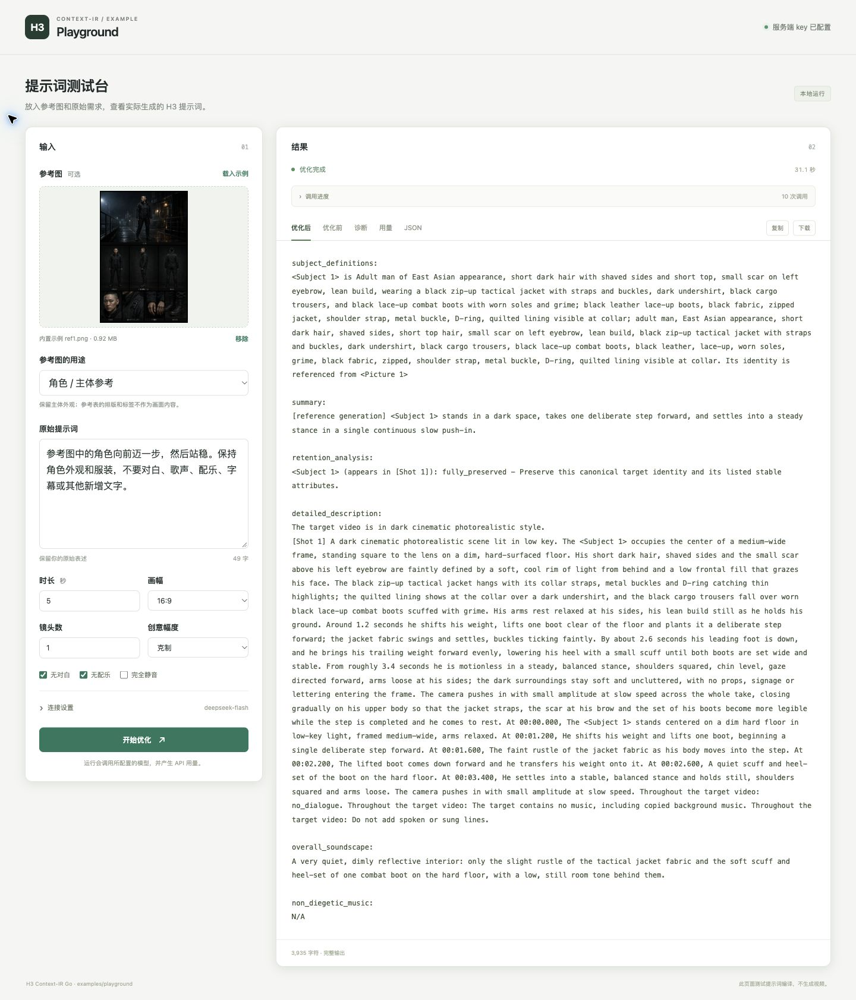

# 本地测试网页

这个示例在本机提供文本和单张参考图的编译表单，直接调用当前 Go 库。网页展示模型阶段、调用用量、编译结果和失败诊断；它不连接 CLW 或其生产环境。

在仓库根目录运行：

```sh
go run ./examples/playground \
  -addr 127.0.0.1:8090 \
  -base-url https://api.deepseek.com/ \
  -model deepseek-flash \
  -api responses \
  -key-env DEEPSEEK_API_KEY \
  -sample-image third_party/open-h3-ir/testdata/golden/assets/ref1.png
```

打开 <http://127.0.0.1:8090/>。监听地址、API 地址、模型和协议默认值就是上面这些值；可以通过对应参数显式修改。默认请求 `deepseek-flash`，返回模型名须与请求一致。供应商确实使用不同的规范模型名时，可通过 `-allowed-response-models` 显式允许；该参数不会更换请求模型。

无需先配置环境变量：可以在网页中输入 API key，随编译请求发送。也可以通过 `-key-env` 指定已有环境变量名。示例不把 key 保存到磁盘，也不把服务端环境 key 返回给网页。环境 key 仅用于启动时配置的 API 地址；在浏览器中更换 API 地址时，应为该请求提供 key。

提交会调用真实模型，使用量按供应商规则计费。示例不会通过切换模型、丢弃图片或生成离线草稿来隐藏失败。

## 输入和结果

- 可以使用纯文本、上传图片，或选择仓库样图。图片限制为一张 PNG/JPEG、最多 10 MiB、最多 1600 万像素。上传内容保存在进程内存中，不写入磁盘。
- 图片职责由表单明确指定：主体、环境、风格或首帧。素材说明不代替图片观察；是否完成感知，可检查 `image_perception` 阶段及其结果。
- 可填写 1–60 秒和 1–10 个镜头，具体组合须通过编译器校验。时间按 24 fps 精确校验，不会暗中四舍五入；例如 5 秒是 120 帧，1.125 秒是 27 帧，1.1 秒不能精确对应整数帧。
- 无对白、无配乐和完全静音是独立选项；完全静音同时禁止对白、音乐和其它声音。
- 进度来自实际模型调用阶段，不代表视频生成进度。成功后可查看 H3 提示词和版本化 Document；失败时仍保留已发生调用的用量。

本网页只编译上下文和提示词，不生成视频。有效的 JSON、通过的 Document 校验和成功的图片感知，都不能单独证明最终视频质量。

## 真实运行截图

2026-10-26，在 Chrome 中点击“载入示例”后执行一轮真实 API 测试：请求与返回模型均为 `deepseek-flash`，参考图用于角色/主体，参数为 5 秒、16:9、1 个镜头。图片感知、完整编译和语义审查通过；10 次模型调用共耗时 31.1 秒，记录输入 34,729 tokens、输出 4,742 tokens。

原始提示词：

> 参考图中的角色向前迈一步，然后站稳。保持角色外观和服装，不要对白、歌声、配乐、字幕或其他新增文字。



[优化前原文](docs/sample-before.txt) · [优化后完整原文](docs/sample-after.txt) · [本轮调用和哈希记录](docs/smoke-test.json)

截图与文本来自本轮实际结果，未使用离线重放或注入故障。耗时与用量仅代表这一次运行。参考图来自仓库固定版本的 OpenH3-IR 测试素材，原始来源和许可见 [第三方说明](../../THIRD_PARTY_NOTICES.md)。

## 本地接口

| 路径 | 用途 |
| --- | --- |
| `GET /` | 测试网页 |
| `GET /sample.png` | 读取 `-sample-image` 指定的仓库样图 |
| `GET /api/config` | 网页使用的公开配置，不包含 key |
| `POST /api/compile` | 提交 multipart 表单，以 SSE 返回阶段、用量和最终结果 |

表单设置 `sample=true` 时使用仓库样图。图片识别、请求构造和模型访问由示例注入；核心库的验证与渲染仍保持确定性，不读取文件、环境或网络。

本地接口测试：

```sh
go test ./examples/playground
```
